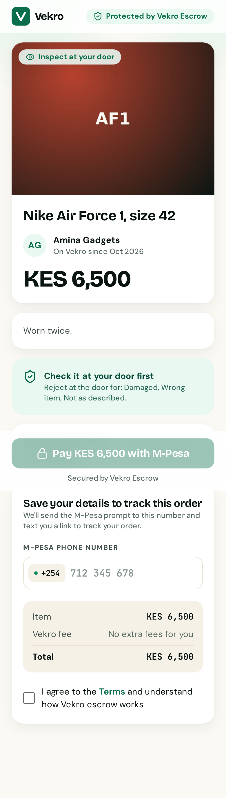
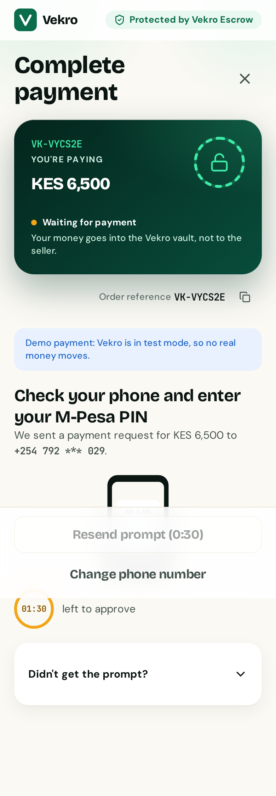
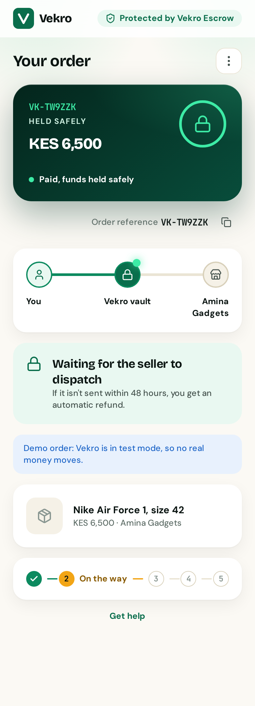
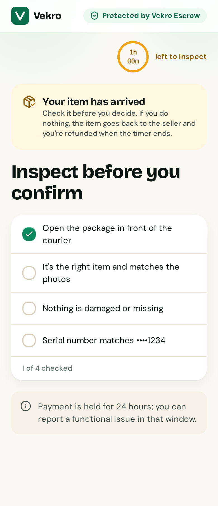
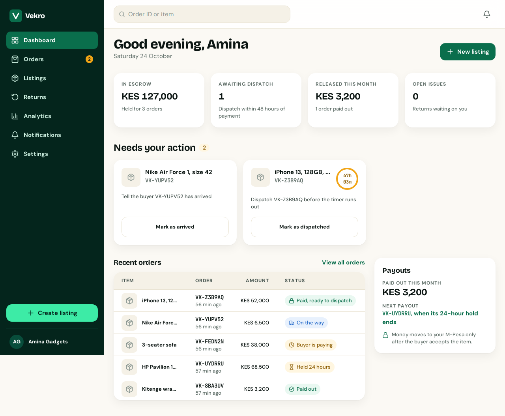
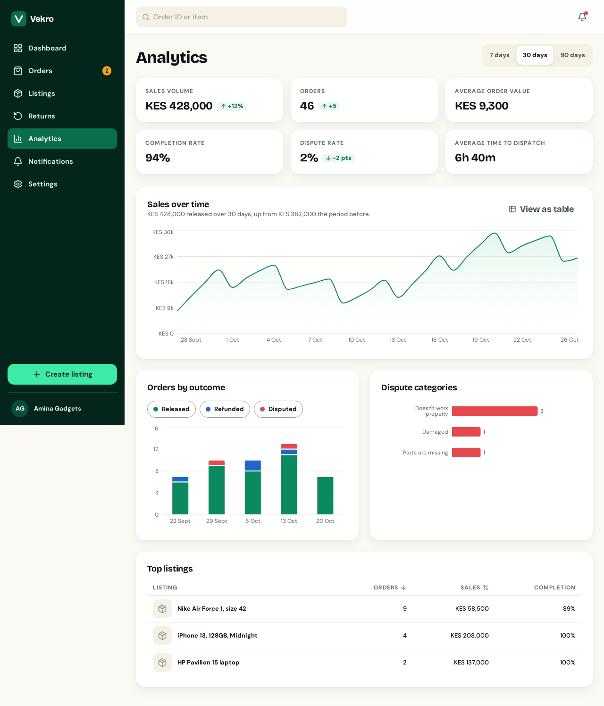
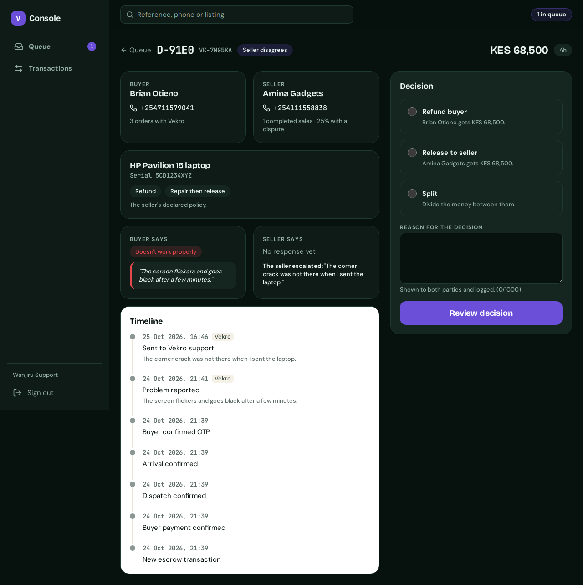
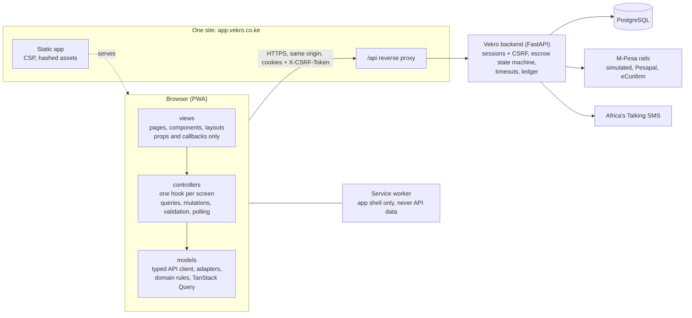

# Vekro Frontend

Web app for Vekro, an escrow trust layer for Kenyan social-commerce sellers. A seller lists an item and shares a Trust Link; the buyer pays by M-Pesa into escrow locked to that one order; the money moves only when someone presses a button (the buyer's delivery code, a refund, a support decision) or a timer runs out.

Backend: [CKmellow/Vekro-backend](https://github.com/CKmellow/Vekro-backend). Delivery is tracked on the [Vekro Frontend Delivery Board](https://github.com/users/CKmellow/projects/2).

| Pay through a Trust Link | Waiting for the M-Pesa PIN | Order tracker | At the door |
| --- | --- | --- | --- |
|  |  |  |  |

| Seller dashboard | Analytics | Support console: case decision |
| --- | --- | --- |
|  |  |  |

## Who uses it

| Actor | Pages |
| --- | --- |
| Buyer (no account wall: a Trust Link, then a phone verified by SMS code) | B1 pay, B2 payment, B3 tracker with the phone gate, B4 inspection, B5 report, B6 return, B7 timeline, B8 sign in, B9 my orders |
| Seller | S1 sign up, S2 log in and reset, S3 payout setup, S4 dashboard, S5 and S6 orders, S7 to S9 listings, S10 and S11 returns, S12 analytics, S13 settings, S14 notifications |
| Support admin | A1 log in, A2 escalation queue, A3 case and binding decision, A4 transactions explorer |
| Everyone | X1 landing, X2 not found and offline, X3 help |

The courier is not a system actor.

## Architecture



- **MVC boundaries are enforced** by ESLint and `scripts/check-boundaries.mjs`: views never import models or call `fetch`; controllers never render; models import only `lib`.
- **The API contract** is `api/openapi.json`, copied from the backend; `npm run api:sync` regenerates `src/models/api/schema.d.ts`. The frontend never invents endpoints: missing capabilities are built in the backend first (`docs/BACKEND_GAPS.md`).
- **The backend's `TransactionStatus` is the authority.** `STATE_META` maps every status to human labels per role; `src/controllers/stateCoverage.test.ts` fails if a new status isn't handled everywhere.
- **Sessions** are server-side cookies with CSRF; nothing sensitive lives in browser storage. Countdowns use server deadlines, never the device clock.
- **Routes are lazy**: one chunk per buyer page, per area for sellers and the console, and a separate chunk for S12's charts. `npm run budget` keeps the buyer pages small in CI.

```
src/app          router, providers, guards, error boundary, CSP
src/models       api (typed client, adapters), schemas, domain (STATE_META, actions, deadlines), queries
src/controllers  one hook per screen; no JSX
src/views        pages, components, layouts; props only
src/lib          money, phone, time, copy, motion
src/styles       design tokens generated from DESIGN.md
src/test         MSW server, fixtures, render helpers (tests only)
e2e              Playwright against the real backend
```

## Getting started

Requirements: Node (see `.nvmrc`), and the backend running locally (see its README; PostgreSQL 16).

```sh
git config core.hooksPath .githooks   # once: the commit-msg hook rejects co-author and AI attribution lines
npm ci
cp .env.example .env.local            # defaults work against a local backend on :8000
npm run dev -- --port 4173            # http://localhost:4173, /api proxied to the backend
```

Demo data: create an admin in the backend (`python -m app.cli create-admin`), then `npm run seed:demo`. The walkthrough is in [docs/DEMO.md](docs/DEMO.md). Every variable is documented in [docs/ENVIRONMENT.md](docs/ENVIRONMENT.md).

## Scripts

| Script | What it does |
| --- | --- |
| `npm run dev` | Vite dev server with the `/api` proxy |
| `npm run build` | type-check and production build (PWA, CSP meta tag) |
| `npm run preview` | serve the production build |
| `npm run lint` | ESLint (zero warnings) and the MVC boundary check |
| `npm run format` / `format:check` | Prettier |
| `npm run typecheck` | TypeScript, strict |
| `npm test` / `test:watch` / `test:coverage` | Vitest and Testing Library (coverage floor enforced in CI) |
| `npm run e2e` | Playwright against the real backend ([e2e/README.md](e2e/README.md)) |
| `npm run budget` | bundle budget for the buyer pages (after a build) |
| `npm run api:sync` | copy the backend's OpenAPI contract and regenerate types |
| `npm run tokens` | regenerate the design tokens from DESIGN.md |
| `npm run seed:demo` | fill a fresh backend with the demo data |

CI (`.github/workflows/ci.yml`) runs lint, format, typecheck, tests with coverage, build and the budget, then the whole Playwright suite (including axe on every page) against the backend's `main`.

## Quality notes

Audits from the hardening milestone: [page states](docs/audits/page-states.md), [accessibility](docs/audits/accessibility.md), [security](docs/audits/security.md), [performance](docs/audits/performance.md).

## Work process

Work happens in issues, one branch per issue, merged into `main` through pull requests (squash-merged once CI is green).

## Agent setup

- Agent instructions (`CLAUDE.md`) are kept locally and are not committed.
- Design and UI skills live in `.agents/skills/` (pinned in `skills-lock.json`) and are exposed to Claude Code through `.claude/skills/`.
- `.vscode/mcp.json` connects VS Code to the Stitch MCP server. The API key is prompted for, never committed.
- Claude Code: copy `.env.example` to `.env`, set `STITCH_API_KEY`, then register the server at local scope so the key stays out of the repo:

  ```sh
  set -a; . ./.env; set +a
  claude mcp add --transport http -s local stitch https://stitch.googleapis.com/mcp --header "X-Goog-Api-Key: $STITCH_API_KEY"
  claude mcp list   # stitch: Connected
  ```
